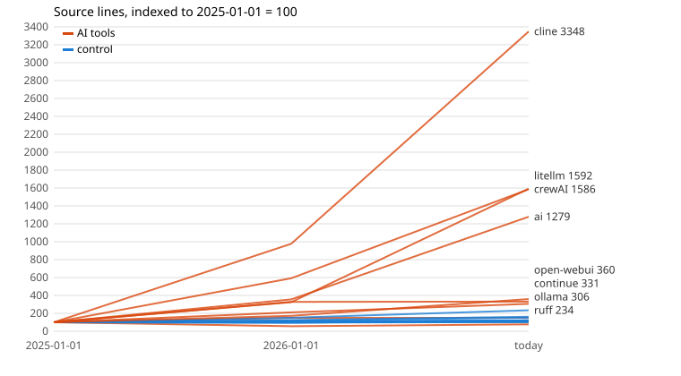

# How fast are codebases growing? 24 repos, 2023 to 2026

I counted source lines in 24 open-source repos on five dates: 2023-01-01,
2024-01-01, 2025-01-01, 2026-01-01 and 2026-11-20. Twelve are AI tools
(coding-agent CLIs, LLM frameworks, model runners), a group where heavy
agent-assisted development is common. Twelve are mature projects used as a
control group (web frameworks, databases, CLI tools, a runtime).

The question: have codebases been growing faster since coding agents became
common?

**Try it on your repo.** Python 3 and git, nothing to install. Swap in your
repo's URL (any public repo, or a local path):

```sh
curl -sL https://raw.githubusercontent.com/krishansubudhi/ratchet/main/scripts/code_growth.py | python3 - https://github.com/OWNER/REPO
```

It prints one CSV row per date: repo, date, commit, files, lines.



## Results

"-" means the repo had no commit before that date. Growth columns compare
two dates; 2025-01→today spans about 23 months.

| Group | Repo | 2023-01 | 2024-01 | 2025-01 | 2026-01 | Today | 2023→24 | 2024→25 | 2025→26 | 2025-01→today |
|---|---|--:|--:|--:|--:|--:|--:|--:|--:|--:|
| AI tool | [Aider-AI/aider](https://github.com/Aider-AI/aider) | - | 10,773 | 25,622 | 38,339 | 38,495 | n/a | +138% | +50% | +50% |
| AI tool | [BerriAI/litellm](https://github.com/BerriAI/litellm) | - | 53,712 | 293,512 | 953,007 | 4,673,304 | n/a | +446% | +225% | +1492% |
| AI tool | [cline/cline](https://github.com/cline/cline) | - | - | 21,538 | 210,513 | 721,167 | n/a | n/a | +877% | +3248% |
| AI tool | [continuedev/continue](https://github.com/continuedev/continue) | - | 45,785 | 97,007 | 318,555 | 321,366 | n/a | +112% | +228% | +231% |
| AI tool | [crewAIInc/crewAI](https://github.com/crewAIInc/crewAI) | - | 1,310 | 26,132 | 154,615 | 414,405 | n/a | +1895% | +492% | +1486% |
| AI tool | [google-gemini/gemini-cli](https://github.com/google-gemini/gemini-cli) | - | - | - | 330,577 | 761,311 | n/a | n/a | n/a | n/a |
| AI tool | [langchain-ai/langchain](https://github.com/langchain-ai/langchain) | 12,388 | 328,012 | 563,775 | 316,091 | 433,978 | +2548% | +72% | -44% | -23% |
| AI tool | [ollama/ollama](https://github.com/ollama/ollama) | - | 13,225 | 141,997 | 299,345 | 434,859 | n/a | +974% | +111% | +206% |
| AI tool | [open-webui/open-webui](https://github.com/open-webui/open-webui) | - | 12,464 | 103,890 | 178,343 | 373,988 | n/a | +734% | +72% | +260% |
| AI tool | [openai/codex](https://github.com/openai/codex) | - | - | - | 270,393 | 2,503,141 | n/a | n/a | n/a | n/a |
| AI tool | [sst/opencode](https://github.com/sst/opencode) | - | - | - | 122,507 | 1,382,738 | n/a | n/a | n/a | n/a |
| AI tool | [vercel/ai](https://github.com/vercel/ai) | - | 9,566 | 81,493 | 289,903 | 1,042,623 | n/a | +752% | +256% | +1179% |
| control | [astral-sh/ruff](https://github.com/astral-sh/ruff) | 53,637 | 237,555 | 366,721 | 553,886 | 856,356 | +343% | +54% | +51% | +134% |
| control | [BurntSushi/ripgrep](https://github.com/BurntSushi/ripgrep) | 41,398 | 50,148 | 50,337 | 52,358 | 56,247 | +21% | +0% | +4% | +12% |
| control | [django/django](https://github.com/django/django) | 457,904 | 469,781 | 490,485 | 514,590 | 539,667 | +3% | +4% | +5% | +10% |
| control | [expressjs/express](https://github.com/expressjs/express) | 16,875 | 16,875 | 19,004 | 19,119 | 19,912 | +0% | +13% | +1% | +5% |
| control | [fastapi/fastapi](https://github.com/fastapi/fastapi) | 58,444 | 108,364 | 112,562 | 105,272 | 136,253 | +85% | +4% | -6% | +21% |
| control | [gin-gonic/gin](https://github.com/gin-gonic/gin) | 17,890 | 18,191 | 19,868 | 22,346 | 24,258 | +2% | +9% | +12% | +22% |
| control | [junegunn/fzf](https://github.com/junegunn/fzf) | 20,513 | 23,085 | 27,846 | 34,730 | 45,113 | +13% | +21% | +25% | +62% |
| control | [pallets/flask](https://github.com/pallets/flask) | 17,293 | 16,530 | 16,987 | 17,375 | 17,530 | -4% | +3% | +2% | +3% |
| control | [psf/requests](https://github.com/psf/requests) | 10,259 | 10,276 | 10,734 | 10,776 | 11,561 | +0% | +4% | +0% | +8% |
| control | [redis/redis](https://github.com/redis/redis) | 152,417 | 150,077 | 162,023 | 192,432 | 246,423 | -2% | +8% | +19% | +52% |
| control | [sqlite/sqlite](https://github.com/sqlite/sqlite) | 436,897 | 461,000 | 460,621 | 441,424 | 472,159 | +6% | -0% | -4% | +3% |
| control | [tokio-rs/tokio](https://github.com/tokio-rs/tokio) | 122,540 | 145,898 | 156,803 | 166,364 | 189,301 | +19% | +7% | +6% | +21% |

Medians across each group (from the same data):

| Period | AI tools | Control |
|---|--:|--:|
| 2023-01 → 2024-01 | +2548% (1 repo) | +4.1% |
| 2024-01 → 2025-01 | +590.0% (8 repos) | +6.0% |
| 2025-01 → 2026-01 | +224.7% (9 repos) | +4.5% |
| 2026-01 → 2026-11-20 | +149.2% (12 repos) | +8.0% |
| 2025-01 → 2026-11-20 | +260.0% (9 repos) | +16.2% |

## Findings

1. **The mature projects are growing faster this year than in any earlier
   year measured.** The control group's median growth was 4.1%, 6.0% and
   4.5% in 2023, 2024 and 2025. In the first 10.6 months of 2026 it was
   8.0%. 9 of the 12 control repos grew more in 2026 so far than in all of
   2025 (the exceptions: django, gin, flask). redis went from +19% to +28%,
   fastapi from -6% to +29%, requests from +0.4% to +7%.
2. **AI tool repos are huge and still growing fast.** openai/codex went from
   270,393 to 2,503,141 lines in 2026 alone (more than 9x). sst/opencode went from
   122,507 to 1,382,738. cline went from 21,538 lines at the start of 2025
   to 721,167 today. gemini-cli did not exist at the start of 2025 and has
   761,311 lines now.
3. **Young projects always grow fast, so the AI group is not a clean
   comparison.** Most AI tool repos started in 2023 or 2024; triple-digit
   percentages on a small base are what young projects do. The more telling
   signal is that their growth did not slow as they got big: vercel/ai grew
   +256% in 2025 from 81,493 lines, then from 289,903 to 1,042,623 in 2026.
4. **Not everything grows.** flask (17,293 → 17,530), sqlite (436,897 →
   472,159) and express (16,875 → 19,912) barely moved over almost four
   years. langchain shrank 44% in 2025, most likely because integrations
   were moved out into separate packages.

So the hypothesis is partly supported: in the control group, median growth
rose to 8.0% in 2026 so far, from 4.1% to 6.0% a year in 2023 to 2025. Whether coding agents caused that
is not something this data can show.

## Method

[`scripts/code_growth.py`](../scripts/code_growth.py), stdlib and git only.
For each repo it makes a bare clone of the default branch and takes
`git rev-list -1 --first-parent --before=<date>` for each date. It counts
newlines in every file that:

- has a code extension (`.py .js .ts .tsx .go .rs .c .h .cpp .java .kt .rb
  .php .cs .swift .sh .vue .svelte .sql .css` and others; full list in the
  script);
- is not under a directory named `vendor`, `third_party`, `node_modules`,
  `dist`, `build`, `target`, `generated`, `docs`, `examples`, `fixtures`,
  `testdata`, `snapshots` or similar;
- is not a lock file, a minified file, or a file with `generated` or `.pb.`
  in its name;
- is 512 KB or smaller and not binary.

Blank lines, comments and tests all count. Raw output for every repo and
date, with commit hashes, is in [`code-growth-data.csv`](code-growth-data.csv).
Rerun: `python scripts/code_growth.py https://github.com/<owner>/<repo>`.
The chart: `python scripts/code_growth.py --svg docs/code-growth-data.csv`.

## Limits

- Line counts are not quality, effort or value. More lines can mean more
  features, more tests, or more mess.
- Growth has many causes: funding, team size, popularity, monorepo moves,
  code moved in or out of a repo. langchain's drop and litellm's size
  (about 2.58 million of its 4.67 million lines sit under `tests/`, from a
  shallow clone taken the same day) are
  examples.
- 24 repos picked by hand is a small sample, not a survey. Picking repos
  that are well known today biases toward projects that grew.
- The groups are not "written by agents" versus "written by people". I do
  not know how much of any repo was written with an agent.
- No claim of causation. The 2026 rise in the control group fits the
  hypothesis, but one year of faster growth in 12 repos is a hint, not proof.
