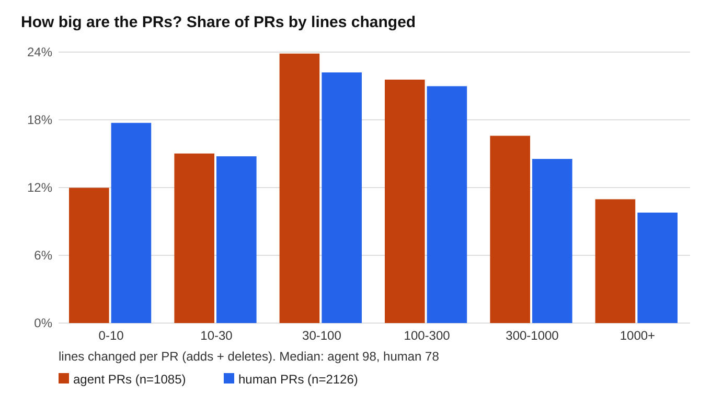
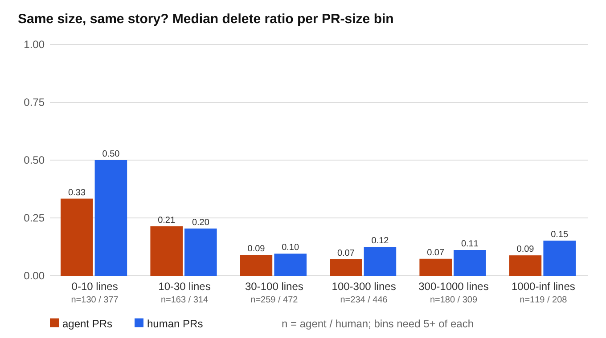
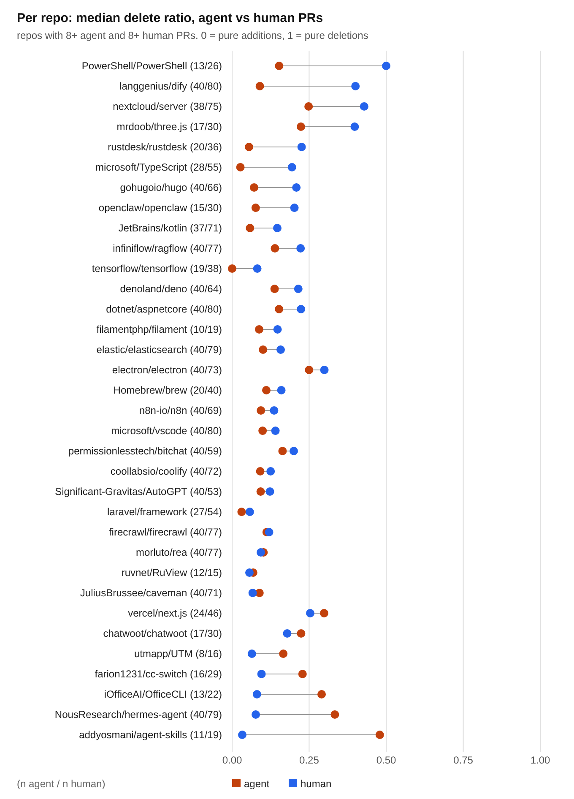

# Do AI coding agents bloat codebases? 3,211 merged PRs say: a little, mostly by being bigger

**Headline:** across 1,085 agent-authored and 2,126 human-authored merged PRs in 68 popular open-source repos (2026), the median agent PR nets +58 lines against +35 for humans, but about half of that gap is just agents taking on bigger changes. Matched on repo and size, an agent PR still nets about 10 more lines (56 vs 46, 95% CI +3 to +18) and deletes a smaller share of what it touches (median delete ratio 0.100 vs 0.143, CI -0.078 to -0.023). The effect is real and consistent in sign, but small. Nothing here supports the claim that agents typically dump enormous additions.

Everything below comes from public GitHub data collected on 2026-10-14. The scripts and the raw data are in this branch, so every number can be re-derived.

## Method

**Population.** Public repos with at least 1,000 stars, not forks, not archived, pushed to since 2026-08-01. For each of 12 languages (Python, JavaScript, TypeScript, Go, Rust, Java, C#, Ruby, PHP, C++, Kotlin, Swift) I took the 10 most-starred repos matching that filter, then dropped link lists, tutorials and docs-only repos by name. That left 101 repos with usable data: 129,251 merged 2026 PRs, listed through the REST API.

**Agent-authored PRs.** A merged 2026 PR counts as agent-authored if it has at least one solid, machine-readable signal:

- the PR body contains `Generated with Claude Code` (835 PRs in the final sample) or a `Co-Authored-By: Claude` trailer (92),
- the PR was opened by a coding-agent account: Copilot coding agent, Devin, Codex or Jules (155),
- the PR body carries the Copilot coding-agent marker (114).

The labels overlap, so these counts add up to more than 1,085. In the 101 repos, 3,783 PRs (2.9%) carry one of these signals. 68 repos have at least one. Claude Code footers dominate the sample, so this is mostly a study of Claude-Code-assisted PRs.

**Human control.** PRs by human accounts (type `User`) in the same repos and the same merge month, with no agent signal in the body. Each sampled agent PR got two human PRs, drawn at random from the same repo and merge month, falling back to the same repo when that month had no match. Every repo with an agent PR got at least 10 human PRs. Bot accounts (Dependabot, Renovate and similar) are excluded from the control. After sampling, I fetched every commit message in each human PR (first 100) and **dropped 177 sampled "human" PRs that carry a `Co-Authored-By: Claude` commit trailer**: these are agent PRs whose PR body hid the signal. They were not moved into the agent group because they were sampled as controls, not as agents.

**Sampling cap.** At most 40 agent PRs per repo, drawn at random, so a few agent-heavy repos (n8n has at least 857 flagged PRs, AutoGPT 541) cannot decide the result. Final sample: **1,085 agent PRs and 2,126 human PRs, 68 repos, 67 of them with both groups.** The sample spans 12 languages: TypeScript 218 agent PRs, Go 156, PHP 125, Rust 99, Python 85, C++ 77, C# 68, JavaScript 66, Swift 55, Ruby 52, Java 43, Kotlin 41.

**Metrics.** From GraphQL, per PR: additions, deletions, changed files, per-file additions and deletions.

- *net lines* = additions - deletions
- *delete ratio* = deletions / (additions + deletions)
- *test share* = additions in test files / all additions (test files: `test/`, `tests/`, `__tests__/`, `*_test.*`, `*.spec.*`, `*.test.*` and similar)
- *source net* = net lines in files that are neither tests nor docs, lockfiles, snapshots, generated code or data files

**Statistics.** Medians (shares for yes/no outcomes), with 95% bootstrap confidence intervals (3,000 resamples). I report two intervals for each agent-minus-human difference: one that resamples PRs, and a more conservative one that resamples whole repos (PRs from one repo are not independent). **Size-matched comparison:** each agent PR is paired with a human PR from the *same repo* whose size (additions + deletions) is within a factor of 1.4 (0.15 in log10), nearest first. That produced 993 pairs in 58 repos with median size 95 vs 94 lines. This answers "agents just do bigger tasks" directly.

## Results

All 1,085 agent PRs vs 2,126 human PRs. Cells show the median with its 95% CI; shares are proportions.

| metric | agent | human | agent - human | 95% CI (PR bootstrap) | 95% CI (repo-clustered) |
|---|---|---|---|---|---|
| lines changed (adds + deletes) | 98 [85, 107] | 78 [69, 88] | +20 | [+3, +32] | [-9, +52] |
| additions | 81 [70, 93] | 60 [54, 66] | +21 | [+9, +35] | [-1, +48] |
| deletions | 7 [6, 8] | 7 [6, 8] | 0 | [-2, +1] | [-2, +2] |
| **net lines** | **58 [48, 65]** | **35 [30, 39]** | **+23** | **[+13, +32]** | **[+4, +41]** |
| **delete ratio** | **0.10 [0.09, 0.12]** | **0.16 [0.14, 0.18]** | **-0.06** | **[-0.09, -0.04]** | **[-0.10, -0.03]** |
| PRs that delete more than they add | 8% | 10% | -2 pts | [-4, 0] | [-4, 0] |
| files changed | 3 [3, 4] | 3 [3, 3] | 0 | [0, +1] | [0, +1] |
| net lines in non-test source files | 9.5 [7, 12] | 5 [4, 6.5] | +4.5 | [+2, +8] | [0, +12] |
| test share of additions | 0.33 [0.23, 0.39] | 0.13 [0.06, 0.22] | +0.20 | [+0.05, +0.29] | [-0.07, +0.36] |

Size-matched: 993 same-repo pairs of nearly equal size (median 95 vs 94 lines changed).

| metric | agent | human | agent - human | 95% CI |
|---|---|---|---|---|
| net lines (median) | 56 | 46 | +10 | [+3, +18] |
| delete ratio (median) | 0.100 | 0.143 | -0.043 | [-0.078, -0.023] |
| delete ratio (mean, paired difference) | 0.193 | 0.220 | -0.027 | [-0.046, -0.008] |
| PRs that delete more than they add | 7.7% | 9.6% | -1.9 pts | [-4.2, +0.4] |



Agent PRs are shifted toward the middle and large sizes and away from tiny ones: 18% of human PRs change fewer than 10 lines, against 12% of agent PRs. The very large tail (1,000+ lines) is similar, 11.0% of agent PRs vs 9.8% of human PRs.



In every size bin from 100 lines up, the agent median delete ratio is lower (0.07-0.09 vs 0.11-0.15), and it is also lower in the smallest bin (0.33 vs 0.50). In the 10-30 and 30-100 line bins the two groups are indistinguishable (0.21 vs 0.20, 0.09 vs 0.10). So the gap lives in large PRs and in tiny ones, not across the board.



Per repo (34 repos with at least 8 PRs in each group): the agent median delete ratio is lower in 24 of 34, and the agent median net is higher in 23 of 34. The repos where agents delete much *more* than humans include several agent-tooling repos (`hermes-agent`, `agent-skills`, `OfficeCLI`, `cc-switch`), so the sign is not universal.

### Robustness

| subset | agent PRs / human PRs | net lines gap (size-matched) | delete ratio gap (size-matched) |
|---|---|---|---|
| all | 1,085 / 2,126 | +10 [+3, +18] | -0.043 [-0.078, -0.023] |
| without the 4 repos with the most agent PRs | 925 / 1,851 | +12 [+4.5, +20.5] | -0.085 [-0.106, -0.048] |
| merged June 2026 or later | 788 / 1,515 | +10 [+1, +17] | -0.047 [-0.071, -0.012] |
| merged before June 2026 | 297 / 611 | +25.5 [+0.5, +39] | -0.072 [-0.112, +0.007] |

The sign does not change in any subset. Early-2026 agent PRs show the biggest gap, though the CI is wide.

## What this does and does not say

- **Per-PR, agents add somewhat more.** The size of the effect is on the order of 10 net lines per PR at equal size, plus the fact that agents take on larger PRs. That is not nothing, but it is nowhere near a 2-3x blowup of the median PR.
- **Means tell a different story than medians.** The mean net per PR is about the same in both groups (316 for agents, 307 for humans), because a few giant PRs in each group dominate the mean. Mean lines changed is 1,400 for agents vs 594 for humans. The tails are where bloat or big refactors live, and this study cannot separate those.
- **Agents may write proportionally more tests** (the median agent PR puts a third of its added lines in test files vs 13% for humans), which would push net lines up without adding production code. The PR-bootstrap CI excludes zero but the repo-clustered one does not, so treat it as suggestive. In non-test source files the gap is +4.5 lines per PR (repo-clustered CI touches zero).
- **PR size is not codebase size.** A merged PR that adds 60 lines may later be deleted, and a PR that adds nothing may leave dead code behind. A proper bloat measure needs the repo's line count over time, ideally split by who wrote what. I looked for reverts (3 agent PRs vs 2 human PRs matched a later `Revert "..."` PR by exact title), but that detector is too crude to conclude anything.

## Caveats

1. **Detection bias.** Agent PRs are found by footers and bot accounts. Agent use without a footer (Cursor, Aider, Codex CLI, Claude Code with the footer turned off) is invisible, so some human-group PRs are agent PRs. That biases results toward "no difference". I measured part of it: 177 of 2,303 body-clean sampled PRs (7.7%) had a Claude commit trailer and were removed. Anything without any trace remains in the control.
2. **Who discloses.** People who leave the footer on are not a random sample of agent users. They may use agents for more, or larger, tasks, or edit less afterwards.
3. **Task mix.** Size matching handles size, not task type. If agents get more feature work and humans more small fixes and cleanups, a delete-ratio gap follows without any bloat tendency in the tool.
4. **Repo selection.** Repos were picked by stars and recency, and only repos with at least one agent PR contribute a human control. That favors agent-friendly repos. 17 of the 101 repos (n8n, vscode, dify, ragflow, next.js, rust, codex and others) have more than ~6,000 recently updated PRs, and the listing stops after 60 pages (6,000 PRs), so their earliest 2026 merges are missing for both groups.
5. **Merged PRs only.** I never saw rejected or abandoned PRs. If agent PRs are rejected more often, or reviewers trim them before merge, the merged sample understates what agents originally wrote.
6. **Lines are a blunt tool.** Net lines include docs, lockfiles and generated code. The source and test splits only see the first 100 changed files of a PR (47 of the 3,211 PRs were truncated and are excluded from those two rows).
7. **No multiple-comparison correction.** About ten metrics, two CI types each, plus subsets. Treat any single borderline interval (test share, source net, the before-June subset) as suggestive.
8. **Claude dominates.** Claude Code footers are the signal on 835 of the 1,085 agent PRs; bot accounts and the Copilot marker cover a minority. This does not generalize cleanly to every agent.
9. **Observational.** None of this shows agents *cause* the gap.

## Reproduce

Needs Python 3.9+ (stdlib only) and an authenticated `gh` CLI. The raw data is committed, so you can start from step 4.

```bash
git checkout study
# 1. pick repos (writes data/raw/repos.jsonl)
python3 scripts/study/repos.py
# 2. list every merged 2026 PR in each repo, with agent flags (data/raw/listing/*.jsonl)
python3 scripts/study/list_prs.py
# 3. fetch size, file and commit detail for the sampled PRs (data/raw/enriched.jsonl)
python3 scripts/study/enrich.py
# 4. metrics, bootstrap CIs, size matching, charts (docs/study/)
python3 scripts/study/analyze.py
```

To skip the GitHub calls, unpack the committed snapshot first: `tar xzf data/study-data.tar.gz` (writes `data/raw/`), then run only `analyze.py`. Sampling is seeded (`SEED` in `enrich.py`), and the bootstrap seed is fixed in `analyze.py`, so rerunning on the snapshot gives the same numbers. A fresh collection will differ as new PRs merge. Full numbers are in `docs/study/results.json`; the per-PR table is `data/raw/pr_metrics.jsonl` inside the snapshot.

## Why this lives in the ratchet repo

[ratchet](https://github.com/krishansubudhi/ratchet) (`pip install ratchet-size`) is a code-size budget that only goes down; coding agents need a human-approved grant to grow it. The study is why it exists: if agents add a bit more code per PR, a budget that makes growth a visible decision is cheap insurance. None of the data above depends on ratchet.
